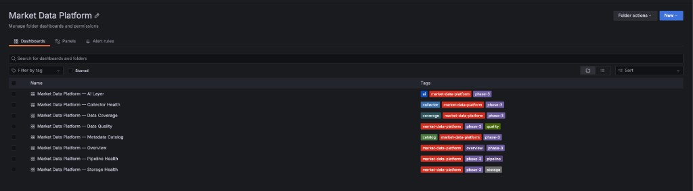
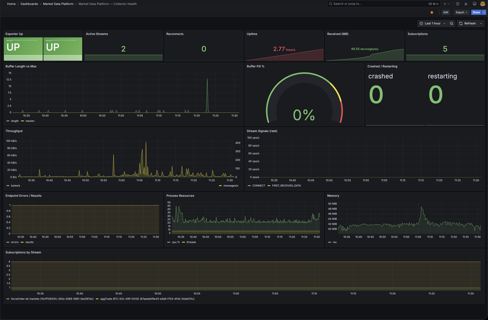
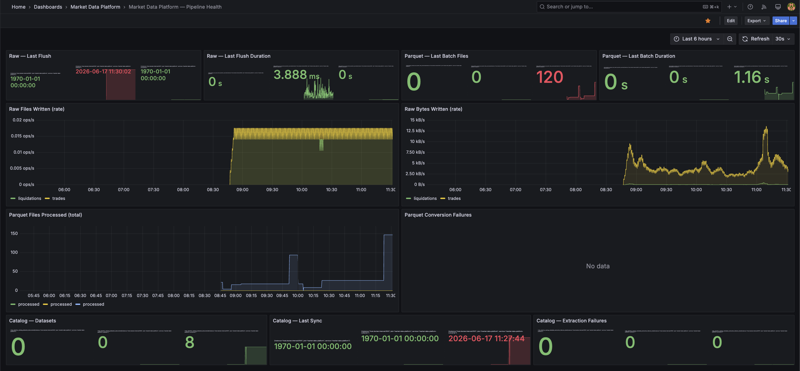
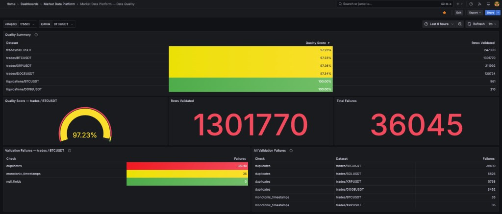

# Pargalı Ibrahim Library

A self-hosted **Binance USDT-M Futures** market data platform: live WebSocket ingestion, hourly Parquet archival, metadata catalog, and Grafana-based operational monitoring.

Built for operators who want a reproducible local pipeline without proprietary SaaS lock-in.

---

## What it does

| Phase | Capability |
|-------|------------|
| **1 — Collection** | Streams agg trades and liquidations for BTC, SOL, XRP, DOGE, ETH, HYPE, BNB via [UBWA](https://github.com/LUCIT-Systems-and-Development/unicorn-binance-websocket-api) into append-only JSONL under `raw/` |
| **2 — Conversion** | Parses, normalizes, and writes ZSTD-compressed Parquet under `data/` on an hourly schedule |
| **3 — Observability** | Prometheus metrics, DuckDB metadata catalog, 8 Grafana dashboards, and 11 alert rules |

```
Binance WS  →  raw/ (JSONL)  →  data/ (Parquet)  →  DuckDB catalog
                      ↓                    ↓
              Prometheus :9100/:9101  →  Grafana :3001
```

---

## Screenshots

Live Grafana dashboards (local OSS at `:3001`, folder **Market Data Platform**):

### Dashboard folder

All eight provisioned dashboards in one folder — Overview, Collector, Pipeline, Storage, Coverage, Quality, Catalog, and AI Layer.



### Collector Health

WebSocket exporter status, active streams, throughput, buffer fill, and process resources.



### Pipeline Health

Raw flush rates, Parquet batch processing, catalog sync, and conversion failures.



### Data Quality

Per-dataset validation scores, duplicate detection, and monotonic timestamp checks.



---

## Requirements

- **Python** 3.11+ (tested on 3.14)
- **Docker** + Docker Compose (monitoring stack only)
- Outbound internet (Binance WebSocket + Docker image pulls)
- ~10 GB free disk for sustained operation (varies with retention)

No Binance API keys are required for public market streams.

---

## Quick start

### 1. Clone and install

```bash
git clone git@github.com:0xanrelins/Pargali-Ibrahim-Library.git
cd Pargali-Ibrahim-Library

python3 -m venv venv
./venv/bin/pip install -r requirements.txt
```

Verify dependencies:

```bash
./venv/bin/python -c "from unicorn_binance_websocket_api import BinanceWebSocketApiManager; print('UBWA OK')"
```

### 2. Start the collector (Terminal 1)

Recommended entry point (includes Prometheus metrics on `:9100`):

```bash
./venv/bin/python -u src/run_collector.py
```

Legacy entry (no metrics wrapper):

```bash
./venv/bin/python -u src/collect_raw.py
```

### 3. Start the converter (Terminal 2)

Hourly loop — also runs storage, coverage, quality, and catalog pollers:

```bash
./venv/bin/python -u src/convert_parquet.py --loop
```

Metrics endpoint: http://127.0.0.1:9101/metrics

One-shot conversion:

```bash
./venv/bin/python src/convert_parquet.py --once
```

### 4. Start monitoring (background)

```bash
cd monitoring
cp .env.example .env   # optional — defaults admin/admin
docker compose up -d
```

| Service | URL |
|---------|-----|
| Grafana | http://localhost:3001 |
| Prometheus | http://localhost:9090 |
| Loki | http://localhost:3100 |

Default Grafana login: `admin` / `admin` (change via `monitoring/.env`).

Open the **Market Data Platform** folder in Grafana for all dashboards.

---

## Project layout

```
├── src/
│   ├── collect_raw.py       # Phase 1 — WebSocket → raw/
│   ├── run_collector.py     # Phase 1 + metrics exporter (:9100)
│   ├── convert_parquet.py   # Phase 2 + catalog/quality pollers (:9101)
│   ├── parse_raw.py         # Parse dry-run helper
│   ├── metrics/             # Prometheus metric registries
│   └── catalog/             # DuckDB sync + AI metadata hooks
├── raw/                     # JSONL (gitignored contents)
├── data/                    # Parquet (gitignored contents)
├── catalog/
│   ├── config.yaml          # Catalog paths + schema version
│   └── catalog.duckdb       # Generated at runtime (gitignored)
├── monitoring/
│   ├── docker-compose.yml   # Grafana, Prometheus, Loki, Promtail
│   ├── prometheus/          # Scrape config
│   ├── grafana/provisioning/# Dashboards, datasources, alerts
│   └── alerts/config.yaml   # Alert thresholds (reference)
├── infra/monitoring/grafana/dashboards/  # Dashboard JSON (source of truth)
├── requirements.txt
├── komutlar.md              # Command cheat sheet (Turkish)
└── AGENTS.md                # Guidance for AI coding agents
```

---

## Data model

**Symbols:** BTCUSDT, SOLUSDT, XRPUSDT, DOGEUSDT, ETHUSDT, HYPEUSDT, BNBUSDT

**Categories:**

- `trades` — aggTrade events
- `liquidations` — forceOrder events

**Parquet layout:**

```
data/{category}/binance_futures/{SYMBOL}/YYYY-MM-DD/HH.parquet
```

**Dataset ID format (catalog):** `trades:binance_futures:BTCUSDT`

Query with DuckDB — see [duckdb-parquet-kontrol.md](duckdb-parquet-kontrol.md) or:

```bash
./venv/bin/python -c "
import duckdb
print(duckdb.connect().execute('''
  SELECT symbol, COUNT(*) AS n
  FROM read_parquet('data/trades/binance_futures/*/*.parquet')
  GROUP BY 1 ORDER BY 1
''').df())
"
```

---

## Monitoring & alerting

Eight dashboards cover collector health, pipeline throughput, storage, coverage, quality, metadata catalog, AI layer, and a top-level overview.

Eleven Grafana-managed alert rules are provisioned from `monitoring/grafana/provisioning/alerting/`. Thresholds are documented in `monitoring/alerts/config.yaml`.

Contact points (`mdp-alerts`, `mdp-alerts-webhook`) are stubs — configure SMTP or a real webhook URL before expecting notifications.

---

## Configuration

| File | Purpose |
|------|---------|
| `catalog/config.yaml` | DuckDB path, raw/data roots, schema version |
| `monitoring/.env` | Grafana admin credentials |
| `monitoring/alerts/config.yaml` | Alert threshold reference |

Symbols and flush intervals are defined in `src/collect_raw.py`. Adjust there for additional markets.

---

## Operational notes

- **No historical backfill** — recording starts when the collector connects. Gaps during downtime are not recovered automatically.
- **WebSocket-only** — REST historical download is out of scope.
- **Liquidations are sparse** — coverage alerts apply to `trades` only to avoid false positives.
- **Prometheus scrapes host ports** — Docker uses `host.docker.internal:9100` and `:9101`; ensure both Python processes are running before expecting dashboard data.

Stop any process with `Ctrl+C`. Stop monitoring with `docker compose down` from `monitoring/`.

---

## Troubleshooting

| Symptom | Check |
|---------|-------|
| Empty Grafana panels | Collector/converter running? `curl localhost:9100/metrics` and `:9101/metrics` |
| Grafana restart loop | Do not set `GF_INSTALL_PLUGINS` for broken plugins; recreate container |
| Catalog empty | Wait for first converter loop (~5 min) or run `--once` |
| High duplicate rate in quality dashboard | Expected with overlapping hourly parquet appends |

More commands: [komutlar.md](komutlar.md)

---

## Disclaimer

This software is provided for research and operational visibility. It is not financial advice. Binance market data is subject to Binance's terms of use. You are responsible for compliance, rate limits, and infrastructure costs.

---

## License

Private repository — all rights reserved unless otherwise specified by the owner.
